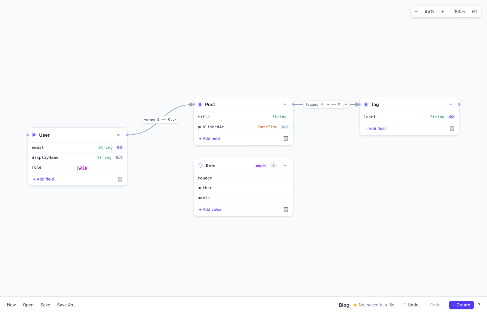

# Domain Modeler

A visual editor for domain models. Lay out entities, enums, and the associations between them on a canvas, then save the model as JSON or export it as a Mermaid ER diagram. It's keyboard-driven (press `?` for shortcuts, `⌘K` for the command palette) and ships as a Tauri desktop app.



## Requirements

- Node and [pnpm](https://pnpm.io)
- [Rust and the Tauri prerequisites](https://v2.tauri.app/start/prerequisites/) for the desktop app

## Develop

```bash
pnpm install
pnpm dev          # frontend only, in the browser
pnpm app:dev      # desktop app
```

## Build

```bash
pnpm build        # frontend bundle in dist/
pnpm app:build    # desktop app bundle
```

## Test

```bash
pnpm test         # unit tests (vitest)
pnpm check        # typecheck, lint, format check, and tests
pnpm test:e2e     # browser smoke test of the production build (Playwright)
```

CI (`.github/workflows/ci.yml`) runs on pull requests and `main`: `pnpm check` and `pnpm build`, `cargo fmt` and `cargo clippy` for the Tauri shell, the Playwright smoke test, and a macOS desktop build.

See [ARCHITECTURE.md](ARCHITECTURE.md) for how the code is put together.
